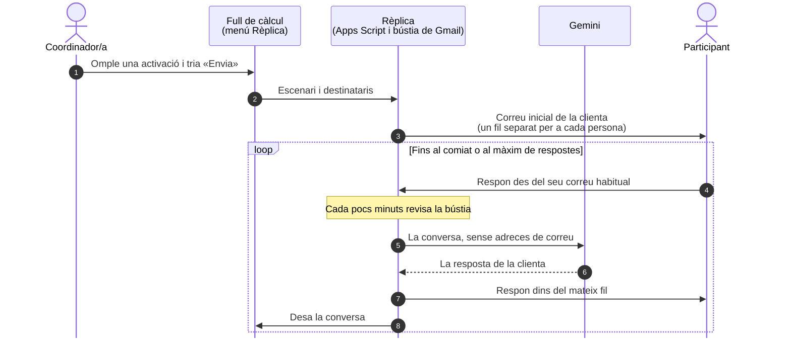

# Rèplica · prova de concepte

Simulador de correspondència comercial per correu electrònic. Cada participant rep un correu d'una **clienta fictícia** (Marta Soler, de Ferreteria Soler SL), que reclama per una comanda incompleta. Respon des del seu correu habitual, i la clienta li torna a contestar dins del mateix fil. Les respostes de la clienta les escriu la intel·ligència artificial **Gemini**.

Aquesta versió és una **prova de concepte** del departament d'Administració i Gestió. Serveix per comprovar que la mecànica funciona, amb poques persones a la vegada. **No** és la plataforma definitiva i **no** avalua ningú.

> ⚠️ **Només amb dades inventades i amb poques persones.** No l'utilitzeu amb alumnat sense l'autorització del centre i del delegat o delegada de protecció de dades. Llegiu abans la secció [Límits de Gmail i de Gemini](#7-límits-de-gmail-i-de-gemini).

---

## Índex

1. [Com funciona](#1-com-funciona)
2. [Què necessites](#2-què-necessites)
3. [Instal·lació pas a pas (sense instal·lar res a l'ordinador)](#3-installació-pas-a-pas)
4. [Configuració](#4-configuració)
5. [Primera prova](#5-primera-prova)
6. [Ús habitual: el menú Rèplica](#6-ús-habitual-el-menú-rèplica)
7. [Límits de Gmail i de Gemini](#7-límits-de-gmail-i-de-gemini)
8. [Problemes freqüents](#8-problemes-freqüents)
9. [Seguretat i privacitat](#9-seguretat-i-privacitat)
10. [Per a desenvolupadors](#10-per-a-desenvolupadors)
11. [Estat del projecte i limitacions](#11-estat-del-projecte-i-limitacions)

---

## 1. Com funciona

El diagrama es llegeix de dalt a baix, pels números. Els passos del requadre es repeteixen a cada resposta del participant.



- Tot funciona dins de Google: **Google Sheets** (el full de càlcul, des d'on es fa servir tot amb el menú **Rèplica**), **Apps Script** (el programa, instal·lat dins del full) i **Gmail** (la bústia que envia els correus de la clienta).
- Una **activació** és una fila del full: un escenari i una o més adreces. En enviar-la, cada persona rep el mateix correu inicial, però **en un fil separat**: ningú no veu les adreces ni les respostes dels altres. A partir d'aquí, cada conversa va per lliure, perquè la clienta respon al que ha escrit cada persona.
- Les respostes **no són instantànies**: el programa mira la bústia cada 5 minuts. Es pot canviar (1, 5, 10, 15 o 30 minuts) a la pestanya **Configuració** del full de càlcul.
- Cada conversa s'acaba quan la clienta queda satisfeta o quan s'arriba al màxim de 6 respostes. Llavors envia un comiat i ja no respon més.

## 2. Què necessites

| Què | Per què | Notes |
| --- | --- | --- |
| **Un compte de Google de prova** (un compte de Gmail nou, per exemple «laboratori.prova.<nom del centre>») | Serà la bústia que envia els correus de la clienta, i la propietària del full de càlcul | Recomanat: un compte nou, només per a això. No feu servir el vostre correu personal ni el del centre. |
| **Un coordinador o coordinadora** | Envia les activacions i supervisa | Fa servir el compte de prova. |
| **Uns quants participants** | Responen a la clienta | Poden fer servir el seu correu habitual. Comenceu amb pocs: vegeu els [límits](#7-límits-de-gmail-i-de-gemini). |
| **Una clau de Gemini** | Perquè la IA escrigui les respostes | Es crea gratis a Google AI Studio (pas 3.5). |
| **Uns 45 minuts** | Per fer la instal·lació la primera vegada | |

No cal instal·lar res a l'ordinador: tot es fa des del navegador.

## 3. Instal·lació pas a pas

Feu **tots** aquests passos havent iniciat sessió amb el **compte de Google de prova**. Si al navegador teniu diversos comptes oberts, és més fàcil fer servir una finestra d'incògnit i entrar-hi només amb el compte de prova.

> 💡 **Ja teníeu Rèplica instal·lat?**
> - A <https://script.google.com> (versió antiga, sense menú): seguiu el [pas 3.9](#39-ja-el-teníeu-installat-a-scriptgooglecom-passar-lo-al-full).
> - Dins del full, amb el menú: seguiu el [pas 3.10](#310-actualitzar-a-una-versió-nova).

### 3.1. Descarregar el codi

1. Obriu <https://github.com/Marcos-A/replica-poc>.
2. Feu clic al botó verd **Code** → **Download ZIP**.
3. Descomprimiu el fitxer. Només en necessitareu dos: **`dist/Replica.gs`** (tot el programa en un sol fitxer) i **`src/appsscript.json`** (els permisos).

> 💡 Per obrir-los i copiar-ne el contingut, feu servir un editor de text senzill (Bloc de notes, TextEdit…), no un processador de textos com Word.

### 3.2. Crear el full de càlcul

1. Aneu a <https://sheets.new> (crea un full de càlcul nou).
2. Poseu-li un nom, per exemple **Rèplica – dades**.

No cal crear les pestanyes: el programa les crearà sol i eliminarà la pestanya buida que Google hi posa per defecte («Full 1» o «Sheet1»).

> ❗ El full ha de ser **del compte de prova** i ha d'estar a **El meu Drive** (no en una unitat compartida). El programa ho comprova: només el propietari del full pot fer servir el menú.

### 3.3. Obrir Apps Script des del full

1. Al full de càlcul, al menú de dalt, feu clic a **Extensions** → **Apps Script**. S'obre una pestanya nova amb l'editor del programa, ja connectat a aquest full.
2. Canvieu el nom del projecte (a dalt, on diu «Projecte sense títol») per **Rèplica**.
3. Feu clic a la roda dentada ⚙️ (**Configuració del projecte**), a l'esquerra:
   - Marqueu **Mostra el fitxer de manifest «appsscript.json» a l'editor**.
   - A **Zona horària**, trieu `(GMT+01:00) Madrid` si no hi és.
4. Torneu a l'editor (icona `< >` a l'esquerra).

### 3.4. Copiar el programa

A l'editor veureu un fitxer anomenat `Codi.gs` (o `Code.gs`) i `appsscript.json`.

1. **`appsscript.json`**: obriu-lo, esborreu-ne tot el contingut i enganxeu-hi el contingut de `src/appsscript.json`. Deseu (icona del disquet o `Ctrl+S`).
2. **`Codi.gs`**: feu clic als tres punts del costat del nom → **Canvia el nom** → escriviu `Replica` (l'editor hi afegeix `.gs`).
3. Obriu **`Replica.gs`**, esborreu-ne tot el contingut (`Ctrl+A` i `Supr`) i enganxeu-hi **sencer** el contingut de `dist/Replica.gs`. És un fitxer llarg: comproveu que comença per `/**` i `Rèplica · prova de concepte` i que la darrera línia és `// ===== FI DE Replica.gs: si veieu aquesta línia, el fitxer és sencer =====`.
4. Deseu.

Al final, a la llista de fitxers de l'editor hi ha d'haver **només** `appsscript.json` i `Replica.gs`.

### 3.5. Crear la clau de Gemini

1. Aneu a <https://aistudio.google.com> amb el compte de prova i accepteu les condicions.
2. Feu clic a **Get API key** → **Create API key**.
3. Copieu la clau (comença per `AIza…`) i tingueu-la a mà: la desareu al pas 4.1. **Tracteu-la com una contrasenya**: no l'envieu per correu, no la poseu en cap document ni al full de càlcul, i no la publiqueu.
4. Trieu un **model**. A AI Studio, al selector de models, copieu-ne l'identificador exacte (per exemple, un model de la família *Flash*, que és ràpid i econòmic). Comproveu a la pàgina de **preus i límits** que aquest model tingui quota gratuïta o que el projecte tingui facturació activada: no tots els models en tenen.

> ℹ️ Amb el nivell gratuït, Google pot fer servir el contingut de les peticions per millorar els seus productes. Per això només s'han de fer servir **dades inventades**. Vegeu la [secció 7](#7-límits-de-gmail-i-de-gemini).

### 3.6. Propietats de l'script

Les propietats de l'script són un espai de l'editor d'Apps Script per a dues dades que no s'han de canviar sense voler: el model de Gemini i l'interruptor general.

1. A Apps Script, roda dentada ⚙️ **Configuració del projecte** → baixeu fins a **Propietats de l'script** → **Afegeix una propietat de l'script**.
2. Afegiu aquestes dues propietats (nom exacte, en majúscules):

| Propietat | Valor | Exemple |
| --- | --- | --- |
| `GEMINI_MODEL` | L'identificador del model triat (pas 3.5) | `gemini-3.5-flash-lite` |
| `SIMULATION_ENABLED` | `false` (de moment) | `false` |

3. Feu clic a **Desa les propietats de l'script**.

> ℹ️ No cal res més aquí. El programa ja sap a quin full està instal·lat; la clau de Gemini la desareu des del menú (pas 4.1), i la llista de participants va a una pestanya del full (pas 4.2).

### 3.7. Fer aparèixer el menú Rèplica

1. Torneu a la pestanya del **full de càlcul** i **recarregueu la pàgina** (`F5` o el botó de recarregar del navegador).
2. Espereu uns segons: a la barra de menús, a la dreta d'**Ajuda**, apareixerà el menú **Rèplica**.

Si no apareix al cap de mig minut, vegeu [Problemes freqüents](#8-problemes-freqüents).

### 3.8. Primera autorització i preparar el full

1. Feu clic a **Rèplica** → **Configuració** → **Prepara el full**.
2. La primera vegada, Google demana permisos:
   - Surt el quadre **Cal autorització** → **D'acord** (o **Continua**) → trieu el **compte de prova**.
   - Sortirà l'avís «**Google no ha verificat aquesta aplicació**». És normal: l'aplicació és vostra. Feu clic a **Configuració avançada** → **Ves a Rèplica (no segur)**.
   - Accepteu els permisos: **Gmail** (enviar i llegir els correus de la simulació), **Fulls de càlcul** (desar les converses), **connexió a serveis externs** (parlar amb Gemini), **activadors** (revisar la bústia periòdicament) i **mostrar contingut en quadres de diàleg** (els missatges del menú Rèplica).
3. Si després d'acceptar no passa res, torneu a fer clic a **Rèplica** → **Configuració** → **Prepara el full**.
4. Sortirà un quadre amb els canvis («Pestanya creada…»). Al full hi veureu sis pestanyes: **Configuració**, **Participants**, **Activacions**, **Escenaris** (amb l'escenari ESC-001 ja carregat), **Converses** i **Missatges**.

L'autorització només es fa una vegada. A partir d'ara, totes les opcions del menú funcionen directament.

### 3.9. Ja el teníeu instal·lat a script.google.com? Passar-lo al full

Les versions anteriors s'instal·laven com a projecte independent a <https://script.google.com>, i no tenien menú. Per passar al menú **sense perdre les converses**, moveu el programa a dins del mateix full de càlcul. Feu-ho tot amb el **compte de prova**.

> ❗ **No hi pot haver mai dos programes revisant la mateixa bústia alhora**: podrien respondre dues vegades. Per això primer s'atura i s'elimina la revisió del projecte antic, i només al final es crea la del nou.

**A. Aturar el projecte antic** (a <https://script.google.com>, projecte **Rèplica**)

1. Obriu el projecte i, a dalt, on hi ha el nom **Rèplica**, feu-hi clic i canvieu-lo per **Rèplica (antic)**. Així, al final, no el confondreu amb el nou.
2. Al desplegable de funcions de la barra superior, trieu **`aturaSimulacions`** → **Executa**.
3. Trieu **`eliminaDisparadors`** → **Executa**.
4. Feu clic a la icona del rellotge ⏰ (**Activadors**), a l'esquerra: la llista ha de quedar **buida**. Si hi queda alguna fila, elimineu-la (tres punts → **Suprimeix l'activador**).
5. Roda dentada ⚙️ → **Propietats de l'script**: copieu en un lloc a mà el valor de `GEMINI_MODEL`, `ALLOWED_SENDERS` (la llista d'adreces) i `GEMINI_API_KEY` (la clau). Les altres no calen.

Mentre feu la resta de passos, les respostes que enviïn els participants esperen a la bústia: no es perden, i es respondran quan activeu el projecte nou.

**B. Instal·lar el programa dins del full**

6. Obriu el **mateix full de càlcul** de sempre (el que té les pestanyes Converses i Missatges).
7. Comproveu que és del compte de prova: **Fitxer** → **Detalls** → **Propietari** ha de ser el compte de prova.
8. Feu els passos [3.3](#33-obrir-apps-script-des-del-full) i [3.4](#34-copiar-el-programa): **Extensions** → **Apps Script**, i enganxeu-hi `appsscript.json` i `Replica.gs`.
9. Feu el pas [3.6](#36-propietats-de-lscript) amb els valors que heu copiat: `GEMINI_MODEL` i `SIMULATION_ENABLED` = `false`. Afegiu-hi **també** `ALLOWED_SENDERS` amb la llista que heu copiat: el programa en passarà les adreces a la pestanya **Participants** al pas següent. **No** hi poseu `SPREADSHEET_ID` ni `GEMINI_API_KEY`.
10. Feu els passos [3.7](#37-fer-aparèixer-el-menú-rèplica) i [3.8](#38-primera-autorització-i-preparar-el-full): recarregueu el full, autoritzeu i feu **Prepara el full**. El quadre dirà, entre altres coses, «Participants copiats d'ALLOWED_SENDERS». Les converses es conserven tal com eren.
11. Ara ja podeu esborrar la propietat `ALLOWED_SENDERS` (⚙️ → **Propietats de l'script** → icona de la paperera al costat). La llista és a la pestanya **Participants**.
12. **Rèplica** → **Configuració** → **Desa la clau de Gemini…** i enganxeu-hi la clau que heu copiat (pas [4.1](#41-desar-la-clau-de-gemini)).
13. **Rèplica** → **Configuració** → **Comprova la configuració**. La línia **Disparador** sortirà com a `[AVÍS]`: és normal, encara no l'heu creada.
14. **Rèplica** → **Revisió automàtica** → **Crea o actualitza**.
15. **Rèplica** → **Simulacions ATURADES · Activa-les…** → **Sí**. Les converses que estaven en curs continuen: a la propera revisió es respondrà el que hagi arribat mentrestant.

**C. Retirar el projecte antic**

16. A <https://script.google.com>, obriu **Rèplica (antic)**: roda dentada ⚙️ → **Propietats de l'script** → esborreu `GEMINI_API_KEY` (així la clau no queda en dos llocs).
17. A la llista de projectes de <https://script.google.com>, feu clic als tres punts de **Rèplica (antic)** → **Suprimeix**. No toqueu el projecte que es diu només **Rèplica**: és el nou.

### 3.10. Actualitzar a una versió nova

Quan hi hagi una versió nova del programa:

1. Descarregueu el ZIP de nou (pas 3.1).
2. Al full, **Extensions** → **Apps Script**. Obriu `Replica.gs`, seleccioneu-ho tot (`Ctrl+A`) i enganxeu-hi el nou `dist/Replica.gs`. Si la versió nova canvia els permisos, feu el mateix amb `appsscript.json`. Deseu.
3. Recarregueu el full i feu **Rèplica** → **Configuració** → **Prepara el full** i després **Comprova la configuració**. Si Google torna a demanar permisos, accepteu-los com al pas 3.8.

Les propietats, el full de càlcul, la clau i la revisió automàtica es conserven: no cal tornar-los a configurar.

> ℹ️ **Si veniu de la versió amb les files `participant` i `escenari` a la pestanya Configuració**: **Prepara el full** crea les pestanyes **Participants** (amb les adreces d'`ALLOWED_SENDERS`, si hi era) i **Activacions**, i treu aquelles dues files de Configuració. A partir d'ara les simulacions s'envien des de la pestanya **Activacions** (secció 6). Després podeu esborrar la propietat `ALLOWED_SENDERS`.

> ❗ **Si teníeu la instal·lació antiga amb 10 fitxers separats** (`AiProvider.gs`, `Config.gs`, `Main.gs`…), suprimiu-los **tots** (tres punts → **Suprimeix**) i deixeu només `appsscript.json` i `Replica.gs`. Si en queda algun d'antic, el programa podria barrejar versions.

> 💡 **Alternativa sense menú**: el programa també es pot instal·lar com a projecte independent a <https://script.google.com> i fer-lo servir des de l'editor d'Apps Script, com en les versions anteriors. Vegeu [docs/instal·lacio.md](docs/instal·lacio.md#alternativa-projecte-independent-sense-menú). Si sabeu fer servir la terminal, també podeu pujar el codi amb `clasp` ([docs/instal·lacio.md](docs/instal·lacio.md#camí-b-pujar-el-codi-amb-clasp)).

## 4. Configuració

La configuració està repartida en aquests llocs:

- **La clau de Gemini**: desada al compte de prova des del menú. No es veu enlloc.
- **Propietats de l'script** (a Apps Script): el model de Gemini i l'interruptor general (`SIMULATION_ENABLED`, que es canvia amb el menú).
- **Pestanya `Participants`**: qui pot rebre simulacions.
- **Pestanya `Configuració`**: els paràmetres del dia a dia, com cada quan es revisa la bústia. Es trien amb llistes desplegables.

### 4.1. Desar la clau de Gemini

1. **Rèplica** → **Configuració** → **Desa la clau de Gemini…**
2. Enganxeu-hi la clau del pas 3.5 i feu clic a **D'acord**.
3. El quadre de resposta ha de dir «**Clau desada**» i «**Comprovació amb Gemini: correcta**». Si diu una altra cosa, reviseu la clau i la propietat `GEMINI_MODEL`.

La clau queda desada al compte de prova: no es veu a les Propietats de l'script, ni al full, ni al codi. Per canviar-la, torneu a fer el mateix amb la clau nova.

### 4.2. Pestanya Participants

Aquí hi ha **totes** les persones que poden participar. Només es pot enviar una simulació a qui és en aquesta llista, i la clienta només respon a qui hi té la casella **actiu** marcada.

| correu | actiu | notes |
| --- | --- | --- |
| docent1@example.org | ☑ | |
| docent2@example.org | ☑ | Grup de dimarts |

1. A la columna **correu**, escriviu una adreça per fila.
2. A la columna **actiu**, marqueu la casella. Si la desmarqueu més endavant, aquella persona no podrà rebre simulacions noves i la clienta deixarà de respondre-li.
3. La columna **notes** és lliure: el programa no la fa servir.

> ❗ **No hi poseu l'adreça de la bústia de prova**: el programa ignoraria els correus o podria crear un bucle.

### 4.3. Pestanya Configuració

Cada fila és un paràmetre: la columna **valor** és la que podeu canviar (fent clic a la cel·la i triant de la llista), i la columna **descripcio** explica què fa.

| Paràmetre (`clau`) | Què és | Valor inicial |
| --- | --- | --- |
| `interval_minuts` | Cada quants minuts es revisa la bústia: 1, 5, 10, 15 o 30. El canvi s'aplica sol a la propera revisió. | `5` |
| `max_torns_per_defecte` | Màxim de respostes de la clienta per conversa (1 a 12), si l'escenari no n'indica cap | `6` |
| `correus_per_dia` | Quants correus pot enviar la bústia en 24 hores: **100** amb un compte de Gmail (el normal), **1500** amb un compte de Google Workspace. Vegeu la [secció 7](#7-límits-de-gmail-i-de-gemini). | `100` |

### 4.4. Comprovar la configuració

1. **Rèplica** → **Configuració** → **Comprova la configuració**.
2. Surt un quadre amb una línia per a cada element. Cada línia ha de començar per `[OK]`, `[INFO]` o `[AVÍS]`. Si n'hi ha alguna amb `[ERROR]`, el text explica què cal corregir.
3. És normal que, en aquest punt, la línia **Disparador** surti com a `[AVÍS]`: el crearem ara.

### 4.5. Activar la revisió automàtica

1. **Rèplica** → **Revisió automàtica** → **Crea o actualitza**. A partir d'ara, el programa revisarà la bústia amb l'interval de la pestanya Configuració (5 minuts, si no l'heu canviat).
2. Mentre les simulacions estiguin aturades (`SIMULATION_ENABLED` = `false`), aquesta revisió no farà res: és l'**interruptor general**.

## 5. Primera prova

1. **Activeu les simulacions**: **Rèplica** → **Simulacions ATURADES · Activa-les…** → **Sí**. Feu-ho només quan el coordinador ho hagi confirmat.
2. Aneu a la pestanya **Activacions** i, a la primera fila buida:
   - a **escenari**, trieu `ESC-001` de la llista;
   - a **destinataris**, escriviu l'adreça del participant (ha de ser a la pestanya Participants, marcada com a activa).
3. Feu clic a qualsevol cel·la d'aquesta fila i trieu **Rèplica** → **Envia l'activació seleccionada…**. El quadre mostra l'escenari i a qui s'enviarà: si és correcte, feu clic a **Sí**.
4. El participant rebrà un correu de **Marta Soler** amb l'assumpte *«Reclamació: comanda CO-2026-0418 incompleta»*. (Si no el veu, que miri a la carpeta de correu brossa.) La fila de l'activació mostra `ENVIADA` i el resultat.
5. El participant **respon** al correu com ho faria amb un client real.
6. Al cap d'uns minuts (com a màxim, l'interval de la pestanya Configuració més el temps que trigui Gemini), rebrà la resposta de la clienta **dins del mateix fil**.
7. Podeu seguir la conversa al full de càlcul, a les pestanyes **Converses** i **Missatges**.

> 💡 Per no haver d'esperar durant una demostració: quan el participant hagi respost, feu **Rèplica** → **Revisa ara les respostes**. Fa el mateix que la revisió automàtica.

## 6. Ús habitual: el menú Rèplica

Tot es fa des del menú **Rèplica** del full de càlcul, havent entrat amb el **compte de prova**. Cada opció mostra un quadre amb el resultat o amb el motiu de l'error. Les opcions que acaben en «…» demanen confirmació abans de fer res.

| Opció del menú | Què fa |
| --- | --- |
| **Envia l'activació seleccionada…** | Envia el correu inicial a tots els destinataris de la fila seleccionada de la pestanya Activacions (cadascun en un fil separat). |
| **Revisa ara les respostes** | Mira la bústia ara mateix i respon el que estigui pendent, sense esperar la revisió automàtica. |
| **Atura la conversa seleccionada…** | Tanca una conversa sense enviar cap comiat (passa a `FINALITZADA`). |
| **Reactiva la conversa seleccionada…** | Torna a `ACTIVA` una conversa en `ERROR`, després de revisar-la. |
| **Estat de les converses** | Resum: si les simulacions estan activades, cada quan es revisa la bústia i les converses obertes. |
| **Simulacions ACTIVADES · Atura-les totes…** | **Interruptor general**: atura tot de seguida. No es respon ni s'envia res fins que es torni a activar. |
| **Simulacions ATURADES · Activa-les…** | Torna a engegar-ho (només amb la confirmació del coordinador). |
| **Revisió automàtica** → **Crea o actualitza** | Crea la revisió periòdica de la bústia amb l'interval de la pestanya Configuració. |
| **Revisió automàtica** → **Elimina…** | La bústia deixa de revisar-se sola. |
| **Configuració** → **Comprova la configuració** | Revisa que tot estigui ben configurat i diu què cal corregir. També diu quants correus queden per avui. |
| **Configuració** → **Prepara el full** | Crea les pestanyes, columnes i llistes desplegables que falten. No esborra converses ni participants. |
| **Configuració** → **Desa la clau de Gemini…** | Desa (o canvia) la clau de Gemini al compte de prova. |

### Enviar una activació

Cada fila de la pestanya **Activacions** és un enviament del correu inicial.

| id_activacio | escenari | destinataris | estat | data_enviament | resultat |
| --- | --- | --- | --- | --- | --- |
| ACT-001 | ESC-001 | docent1@example.org, docent2@example.org | ENVIADA | 20/11/2026 10:05 | 2 enviat(s) |
| | ESC-001 | docent3@example.org | | | |

1. A la primera fila buida, ompliu **només** dues columnes:
   - **escenari**: trieu-lo de la llista.
   - **destinataris**: una o més adreces de la pestanya Participants, separades per comes (o una per línia, amb `Ctrl+Retorn` dins de la cel·la).
2. Feu clic a qualsevol cel·la de la fila i trieu **Rèplica** → **Envia l'activació seleccionada…**
3. El quadre mostra l'escenari i la llista de persones. Si és correcte, feu clic a **Sí**.
4. El programa omple la resta de columnes: l'identificador (`ACT-001`, `ACT-002`…), l'estat, la data i el resultat.

Què heu de saber:

- **Tothom rep el mateix correu inicial** (l'assumpte i el text de l'escenari), però cadascú en el seu propi fil: ningú no veu les altres adreces. Després, cada conversa és diferent, perquè la clienta respon al que escriu cada persona.
- **Si alguna adreça no és a la pestanya Participants** (o no hi està marcada com a activa), **no s'envia res** i el quadre diu quina és. Corregiu-la i torneu-ho a provar.
- **Qui ja té una conversa oberta del mateix escenari no el torna a rebre.** El quadre i la columna resultat ho indiquen.
- **Una fila `ENVIADA` no es pot tornar a enviar.** Per a una ronda nova, afegiu una fila nova.
- **Si la fila queda `PARCIAL`** (algun enviament ha fallat), la columna resultat diu a qui i per què. Quan ho hàgiu resolt, torneu a enviar **la mateixa fila**: només s'enviarà a qui falti.
- **Si l'activació faria passar del límit de correus del dia**, no s'envia i el quadre diu quants en queden (vegeu la [secció 7](#7-límits-de-gmail-i-de-gemini)).

### Aturar o reactivar una conversa

1. Aneu a la pestanya **Converses** i feu clic a **qualsevol cel·la de la fila** de la conversa (no a la capçalera). També podeu fer clic a una fila de la pestanya **Missatges**: s'agafarà la conversa d'aquell missatge.
2. Trieu **Rèplica** → **Atura la conversa seleccionada…** (o **Reactiva…**).
3. El quadre mostra la conversa triada (participant, estat, respostes i darrer error). Si és la correcta, feu clic a **Sí**.

Abans de **reactivar** una conversa en `ERROR`, obriu el fil a la bústia de prova (Gmail) i comproveu que la darrera resposta de la clienta **no** s'ha enviat. Si sí que s'ha enviat, no la reactiveu: atureu-la, per no duplicar la resposta.

### Treballar amb altres docents

Podeu compartir el full de càlcul amb altres docents perquè segueixin les converses o hi afegeixin participants:

- **Només el compte de prova pot fer servir el menú Rèplica.** Les opcions s'executen amb el compte de qui hi fa clic, i els correus sortirien del seu Gmail. Per això el programa ho comprova i, si és un altre compte, no fa res i ho explica.
- Si un altre docent fa clic al menú, Google li pot demanar que autoritzi l'aplicació. **Ha de fer clic a Cancel·la**: no cal, i el menú no li funcionaria igualment.
- **Qui pot editar el full pot afegir participants i també pot obrir Apps Script** (Extensions → Apps Script), veure-hi el codi i les propietats, i canviar-los. Compartiu-lo amb permís d'edició **només amb persones de confiança**. Si algú només ha de mirar, doneu-li permís de **lectura**: no veurà el menú ni el codi.

Instruccions detallades: [docs/operacio.md](docs/operacio.md).

## 7. Límits de Gmail i de Gemini

Rèplica funciona amb serveis **gratuïts** de Google, i aquests serveis tenen límits. Amb una prova de pocs participants no hi arribareu, però és important conèixer-los abans d'afegir-ne més.

### Gmail: correus per dia

| Tipus de compte | Correus que pot enviar el programa en 24 hores |
| --- | --- |
| Compte de Gmail normal (el recomanat per a la prova) | **unes 100** |
| Compte de Google Workspace (per exemple, del centre) | **unes 1.500** |

- Compten **tots** els correus de la clienta: cada correu inicial i cada resposta.
- Cada conversa pot arribar a fer servir **1 + 6 correus** (l'inicial i fins a 6 respostes, amb el valor per defecte de `max_torns_per_defecte`).
- **Compte ràpid**: amb un compte de Gmail i 6 respostes per conversa, no inicieu més de **14 converses en 24 hores** (14 × 7 = 98). Si en voleu més, reduïu `max_torns_per_defecte` o repartiu-les en dies diferents.
- El programa porta el compte a partir del full (fila `correus_per_dia` de la pestanya Configuració):
  - Si una activació faria passar del límit, **no s'envia** i el quadre diu quants correus queden.
  - Si s'arriba al límit enmig de les converses, les respostes **esperen** (no es perden) i surten soles quan torna a haver-hi marge.
  - **Comprova la configuració** mostra quants correus s'han enviat en les darreres 24 hores i quants en queden.

### Gemini: nivell gratuït

- **Límits de peticions.** El nivell gratuït permet un nombre limitat de peticions **per minut** i **per dia**. Cada resposta de la clienta és una petició. Els límits depenen del model i Google els canvia sovint: consulteu-los a Google AI Studio (pàgina de límits o *rate limits*) per al model que hàgiu triat.
- **Què passa si s'hi arriba.** La resposta no s'envia, a la columna `darrer_error` de la conversa surt `HTTP 429`, i el programa ho torna a provar sol a la revisió següent. Si passa sovint, espereu o feu servir menys participants a la vegada.
- **Ús de les dades.** Amb el nivell gratuït, **Google pot fer servir el text que s'envia a Gemini per millorar els seus productes**, i el poden revisar persones. El programa treu les adreces de correu abans d'enviar el text, però el contingut dels missatges sí que s'envia. Per això:
  - Feu servir **només dades inventades**.
  - **No ho feu servir amb alumnat amb el nivell gratuït.** Per fer-ho amb alumnes caldria, com a mínim, l'autorització del centre i del delegat o delegada de protecció de dades, i un nivell de pagament de Gemini, que no fa servir les dades d'aquesta manera.

### Apps Script: temps d'execució

Amb un compte de Gmail, Google limita el temps total que el programa es pot executar sol (unes 1,5 hores al dia). Amb la revisió cada 5 minuts hi ha marge de sobres. Amb `interval_minuts` a 1, feu-lo servir només durant demostracions i torneu a 5 després.

## 8. Problemes freqüents

| Què passa | Causa probable | Solució |
| --- | --- | --- |
| El menú **Rèplica** no apareix | El full no s'ha recarregat després d'enganxar el codi, o el codi no s'ha desat | Recarregueu la pàgina i espereu uns segons. Comproveu a **Extensions** → **Apps Script** que `Replica.gs` està desat i sencer (pas 3.4) |
| El menú no apareix a un altre docent | És intencionat si Google sap que no és el compte de prova | Només el compte de prova fa servir el menú (vegeu [Treballar amb altres docents](#treballar-amb-altres-docents)) |
| `Només el compte de prova (…) pot fer servir Rèplica` | Heu obert el full amb un altre compte | Obriu el full havent entrat **només** amb el compte de prova (per exemple, en una finestra d'incògnit) |
| `No es pot saber de qui és el full de càlcul` | El full és en una unitat compartida | Creeu el full a **El meu Drive** del compte de prova |
| Després d'autoritzar, no passa res | Google no executa l'opció la primera vegada | Torneu a fer clic a la mateixa opció del menú |
| `Les simulacions estan aturades` | L'interruptor general està apagat | **Rèplica** → **Simulacions ATURADES · Activa-les…** |
| `Aquestes adreces no són a la pestanya Participants…` | Hi ha una adreça mal escrita, o la persona no és a Participants, o no hi té la casella actiu | Corregiu l'adreça o afegiu-la a Participants amb la casella marcada, i torneu a enviar la fila |
| `Aquesta activació (…) ja s'ha enviat` | La fila ja és `ENVIADA` | Per a una ronda nova, afegiu una fila nova a Activacions |
| `No cal enviar res` | Tots els destinataris ja tenen una conversa oberta d'aquest escenari | Acabeu-les o atureu-les abans (**Atura la conversa seleccionada…**) |
| `Aquesta activació enviaria N correus, però … només en queden …` | S'arribaria al límit diari de Gmail | Envieu-la més tard o repartiu els destinataris en dues activacions (vegeu la [secció 7](#7-límits-de-gmail-i-de-gemini)) |
| `Respostes en espera pel límit de correus diari` | S'ha arribat al límit diari de Gmail | No cal fer res: surten soles quan hi torna a haver marge |
| `No hi ha cap cel·la seleccionada` / `Heu seleccionat la capçalera` | No s'ha triat cap fila | Feu clic a una cel·la de la fila (Activacions per enviar; Converses per aturar o reactivar) |
| `[ERROR] Participants: no hi ha cap participant` | La pestanya Participants és buida o ningú no hi té la casella actiu | Afegiu-hi adreces i marqueu la casella **actiu** |
| `[AVÍS] Propietat ALLOWED_SENDERS: ja no s'utilitza` | Venieu d'una versió anterior | Comproveu que les adreces són a la pestanya Participants i esborreu la propietat |
| `[ERROR] Clau de Gemini: falta` | La clau no s'ha desat | **Configuració** → **Desa la clau de Gemini…** |
| `[AVÍS] Clau de Gemini: és a les Propietats de l'script` | La clau és on la poden veure els editors del full | **Configuració** → **Desa la clau de Gemini…**: la passa al compte de prova i l'esborra de les propietats |
| `Codi incomplet a l'editor`, `[ERROR] Codi: falta …` o `… is not defined` | El codi enganxat a l'editor no és complet | Torneu a enganxar `dist/Replica.gs` sencer a `Replica.gs` (pas 3.4) i comproveu que no hi queden fitxers antics |
| El participant respon però no arriba res | Encara no ha passat l'interval de revisió, l'interruptor és apagat, o la persona no té la casella actiu | Espereu o feu **Revisa ara les respostes**; mireu la pestanya Participants i el full (columna `darrer_error`) |
| `darrer_error` diu `HTTP 429` | S'ha arribat al límit de Gemini | El programa ho tornarà a provar sol; vegeu la [secció 7](#7-límits-de-gmail-i-de-gemini) |
| `darrer_error` diu `HTTP 400` o `403` | La clau o el model no són correctes | Torneu a desar la clau, reviseu `GEMINI_MODEL`, feu **Comprova la configuració** i després **Reactiva la conversa seleccionada…** |
| La conversa queda en `ERROR` amb «No consta que la resposta s'enviés» | Una execució es va interrompre mentre enviava | Mireu el fil a Gmail. Si la resposta no hi és, reactiveu-la; si hi és, atureu-la |

## 9. Seguretat i privacitat

- La clau de Gemini es desa **al compte de prova** (Rèplica → Configuració → Desa la clau de Gemini). **Mai** la poseu al codi, al full de càlcul ni a GitHub.
- **Qui pot editar el full pot canviar qui participa i també el programa**: pot afegir adreces a la pestanya Participants, obrir Apps Script i veure'n el codi i les propietats. Compartiu el full amb permís d'edició només amb persones de confiança; per a la resta, permís de lectura.
- Només el compte de prova, propietari del full, pot fer servir el menú i la revisió automàtica. Així cap correu de la simulació surt del compte d'un altre docent.
- Les adreces dels participants són **dades personals**: compartiu el full de càlcul i la bústia de prova només amb qui ho necessiti.
- Amb el nivell gratuït de Gemini, Google pot fer servir el text de les converses: **només dades inventades** (vegeu la [secció 7](#7-límits-de-gmail-i-de-gemini)).
- El programa ignora els correus de persones que no són a la pestanya Participants (o no hi estan actives), les respostes automàtiques («fora de l'oficina»), les notificacions d'error de lliurament i els correus de la mateixa bústia. No llegeix adjunts.
- Abans d'enviar el text a Gemini, s'eliminen les adreces de correu i el text citat dels missatges.
- No hi ha anonimat absolut: Gmail conserva les metadades i el full registra les adreces.

**Per acabar la prova i esborrar-ho tot**: vegeu [docs/operacio.md › Desinstal·lar](docs/operacio.md#desinstallar-i-esborrar-dades).

## 10. Per a desenvolupadors

```text
replica-poc/
├── src/                     Codi d'Apps Script (rootDir de clasp)
│   ├── appsscript.json      Manifest: zona horària, V8 i permisos OAuth
│   ├── Main.js              Funcions públiques, activacions, disparador i comprovació del compte
│   ├── Menu.js              Menú «Rèplica» del full (onOpen) i quadres de diàleg
│   ├── Config.js            Script Properties, clau de Gemini i límits
│   ├── SheetsRepository.js  Accés a Sheets (Configuració, Participants, Activacions, Escenaris, Converses, Missatges)
│   ├── GmailGateway.js      Accés a Gmail, neteja de text i filtres
│   ├── ConversationService.js  Lògica de conversa, torns, límit diari, reconciliació i tancament
│   ├── PromptBuilder.js     Instruccions per a la IA
│   ├── AiProvider.js        Abstracció del proveïdor (generaResposta)
│   ├── GeminiProvider.js    Adaptador de Gemini (Interactions API)
│   ├── EscenariInicial.js   Escenari ESC-001
│   └── Logger.js            Registres amb dades sensibles emmascarades
├── dist/Replica.gs          FITXER GENERAT: tot src/*.js en un sol fitxer (npm run build)
├── test/                    Proves amb dobles de Gmail, Sheets, Gemini i del menú
├── exemples/escenari-001.json
├── scripts/build.js         Genera dist/Replica.gs
├── scripts/pre-commit.sh    Hook: no deixa fer commit de src/ amb dist/ desfasat
├── scripts/clasp.sh         clasp dins de Docker
├── .github/workflows/       Proves automàtiques a GitHub a cada push
└── docs/                    Instal·lació, operació i proves
```

Ordres (amb Node.js 22 o amb Docker, sense instal·lar res):

```sh
# Després de canviar qualsevol fitxer de src/, regenereu el fitxer únic
npm run build

# Proves automàtiques (no envien correus ni criden Gemini).
# Fallen si dist/Replica.gs no està al dia amb src/.
npm test
docker run --rm --network none -u "$(id -u):$(id -g)" -v "$PWD":/app -w /app node:22-alpine sh -c "npm run build && npm test"

# Una vegada per clon: hook que regenera dist/Replica.gs (amb Docker) i
# atura el commit si src/ i dist/ no coincideixen
ln -s ../../scripts/pre-commit.sh .git/hooks/pre-commit

# Pujar el codi a Apps Script amb clasp 3.4.1
./scripts/clasp.sh login --no-localhost
./scripts/clasp.sh push
```

`dist/Replica.gs` s'ha de mantenir al dia amb `src/` per tres vies: el hook `pre-commit` (si el teniu instal·lat), la prova automàtica que compara tots dos fitxers, i GitHub Actions, que executa `npm test` a cada push i pull request **sense** regenerar `dist/` (si està desfasat, el commit surt amb ❌).

> Si teniu `core.hooksPath` configurat globalment, git no executa `.git/hooks/` del repositori: el hook global `pre-commit` ha de passar el control a `$(git rev-parse --git-common-dir)/hooks/pre-commit`.

Documentació tècnica:

- [docs/instal·lacio.md](docs/instal·lacio.md): projecte vinculat i independent, clasp, permisos OAuth, versió de l'API de Gemini, quotes i passos exactes.
- [docs/operacio.md](docs/operacio.md): activacions, supervisar, recuperar, aturar i desinstal·lar.
- [docs/proves.md](docs/proves.md): proves d'acceptació, executades i pendents.

## 11. Estat del projecte i limitacions

- ✅ Codi complet i **82 proves automàtiques** superades amb dobles de prova.
- ✅ **Verificat en real (19/11/2026)**: enviament del correu inicial, recepció, resposta del participant, generació amb Gemini i resposta automàtica dins del mateix fil (amb un sol participant i la instal·lació independent, des de l'editor).
- ⏳ **Pendents de verificar en real**: el menú Rèplica i la instal·lació dins del full, les activacions amb diversos participants a la vegada, el límit diari de correus, execució doble, missatges consecutius, intents de revelar dades reservades, tancament de la conversa i límit de torns. Vegeu [docs/proves.md](docs/proves.md).
- Pensat per a **pocs participants** a la vegada: vegeu els [límits de Gmail i de Gemini](#7-límits-de-gmail-i-de-gemini).
- Les respostes poden trigar diversos minuts (revisió periòdica, no instantània). Cada revisió genera com a màxim 10 respostes; la resta surten a la revisió següent.
- Una sola bústia i un sol personatge per escenari. Tots els destinataris d'una activació reben el mateix correu inicial.
- No es pot garantir que cada resposta s'enviï **exactament una vegada** en tots els casos d'error; el programa prioritza **no duplicar** respostes i, si dubta, deixa la conversa en `ERROR` per revisar-la a mà.
- Sense avaluació automàtica: el docent revisa el fil i el full manualment.

---

## Nota sobre el desenvolupament

Aquest projecte s'ha desenvolupat sota direcció i revisió humanes, amb el suport d'eines d'intel·ligència artificial per a parts del codi, la depuració i la documentació. Les decisions sobre el funcionament del sistema i la responsabilitat del resultat final corresponen a la persona que manté el projecte.
